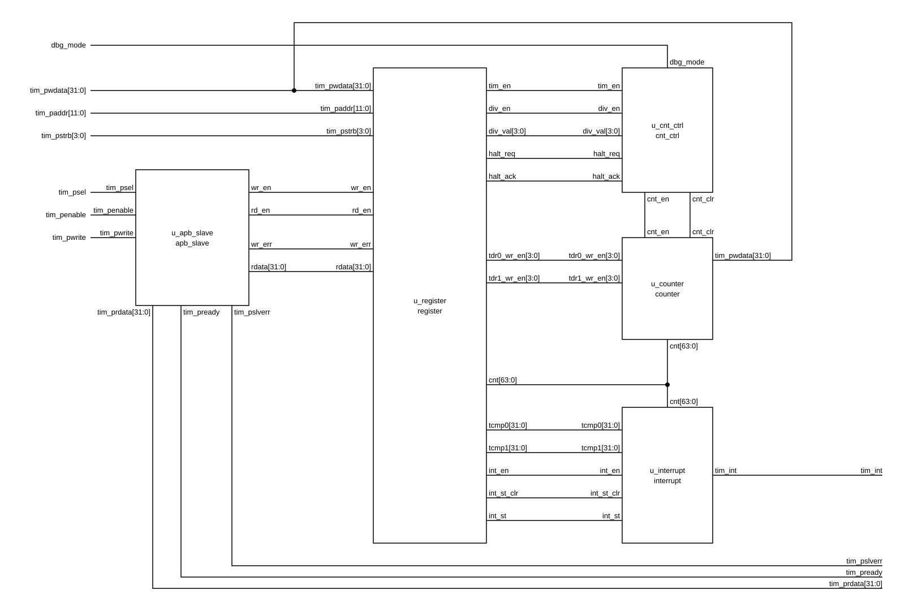

# Timer_IP

A 64-bit APB timer IP in Verilog-2005, derived from the RISC-V CLINT timer.

_VI:_ Timer IP 64-bit giao tiếp APB, viết bằng Verilog-2005, tùy biến từ timer CLINT của RISC-V.

A 64-bit up counter `cnt` = {TDR1, TDR0} is compared continuously with {TCMP1, TCMP0}. When they are equal, `TISR.INT_ST` is set and, if `TIER.INT_EN` = 1, the level interrupt `tim_int` is raised.

_VI:_ Bộ đếm lên 64-bit `cnt` = {TDR1, TDR0} được so sánh liên tục với {TCMP1, TCMP0}. Khi bằng nhau, `TISR.INT_ST` được set và nếu `TIER.INT_EN` = 1 thì ngắt mức `tim_int` lên 1.

## Features / Tính năng

- APB slave: 12-bit address, 32-bit data, byte strobes `tim_pstrb[3:0]`, one wait state, error response (`tim_pslverr`)
- 64-bit up counter that software can write while the timer is stopped
- Count speed divided by 2^DIV_VAL (DIV_VAL = 0..8) when `TCR.DIV_EN` = 1; this is a count enable, not a clock divider
- Hardware clears the counter when `TIM_EN` goes from 1 to 0
- Counter halts in debug mode (`dbg_mode` & `THCSR.HALT_REQ` → `HALT_ACK`)
- One clock domain `sys_clk`, asynchronous active-low reset `sys_rst_n`

_VI:_

- APB slave: địa chỉ 12-bit, dữ liệu 32-bit, byte strobe `tim_pstrb[3:0]`, một chu kỳ chờ, error response (`tim_pslverr`)
- Bộ đếm lên 64-bit, phần mềm ghi được khi timer đang dừng
- Tốc độ đếm chia theo 2^DIV_VAL (DIV_VAL = 0..8) khi `TCR.DIV_EN` = 1; đây là tín hiệu cho phép đếm, không phải chia clock
- Phần cứng xóa bộ đếm khi `TIM_EN` chuyển từ 1 về 0
- Bộ đếm dừng (halt) trong debug mode (`dbg_mode` & `THCSR.HALT_REQ` → `HALT_ACK`)
- Một miền clock `sys_clk`, reset bất đồng bộ tích cực mức thấp `sys_rst_n`

## Architecture / Kiến trúc



| Instance | Module | Role |
| --- | --- | --- |
| `u_apb_slave` | `apb_slave` | APB transfer: wait state, error response, `wr_en`/`rd_en` |
| `u_register` | `register` | Address decode, TCR/TCMP0/TCMP1/TIER/THCSR, byte write, `wr_err`, TDR write enables, read mux |
| `u_cnt_ctrl` | `cnt_ctrl` | `cnt_en` from TIM_EN/DIV_EN/DIV_VAL, halt, `cnt_clr` when TIM_EN goes 1 → 0 |
| `u_counter` | `counter` | 64-bit counter {TDR1, TDR0}: count, byte write, clear |
| `u_interrupt` | `interrupt` | Compare `cnt` with {TCMP1, TCMP0}, INT_ST, `tim_int` |

`timer_top` only instantiates and connects the five modules; it has no glue logic.

_VI:_ `timer_top` chỉ instance và nối dây năm module con; không có glue logic.

## Top-level interface / Giao tiếp mức top

| Port | Dir | Width | Description |
| --- | --- | --- | --- |
| `sys_clk` | in | 1 | System clock, rising edge |
| `sys_rst_n` | in | 1 | Asynchronous active-low reset |
| `tim_psel` / `tim_penable` / `tim_pwrite` | in | 1 | APB control |
| `tim_paddr` | in | 12 | APB address, decoded on `[11:2]` |
| `tim_pwdata` | in | 32 | APB write data |
| `tim_pstrb` | in | 4 | Byte write strobes |
| `tim_prdata` | out | 32 | APB read data |
| `tim_pready` | out | 1 | APB ready (0 in the wait cycle) |
| `tim_pslverr` | out | 1 | Write error |
| `tim_int` | out | 1 | Timer interrupt, active-high, level |
| `dbg_mode` | in | 1 | Debug mode, used for halt |

## Register map / Bảng thanh ghi

| Offset | Name | Reset | Description |
| --- | --- | --- | --- |
| 0x00 | TCR | 0x0000_0100 | Control: `TIM_EN` [0], `DIV_EN` [1], `DIV_VAL` [11:8] |
| 0x04 | TDR0 | 0x0000_0000 | Counter `cnt[31:0]` |
| 0x08 | TDR1 | 0x0000_0000 | Counter `cnt[63:32]` |
| 0x0C | TCMP0 | 0xFFFF_FFFF | Compare value [31:0] |
| 0x10 | TCMP1 | 0xFFFF_FFFF | Compare value [63:32] |
| 0x14 | TIER | 0x0000_0000 | `INT_EN` [0] |
| 0x18 | TISR | 0x0000_0000 | `INT_ST` [0], write 1 to clear |
| 0x1C | THCSR | 0x0000_0000 | `HALT_REQ` [0], `HALT_ACK` [1] (RO) |

Unlisted addresses read 0 and ignore writes. A write to TCR returns `tim_pslverr` = 1, and changes nothing, if it sets DIV_VAL > 8 or changes DIV_VAL/DIV_EN while TIM_EN = 1. Writes to TDR0/TDR1 while TIM_EN = 1 are ignored without an error (OPEN-002). The full map is in [register_map.md](doc/spec/register_file/register_map.md).

_VI:_ Địa chỉ không liệt kê đọc ra 0 và bỏ qua lệnh ghi. Lệnh ghi TCR trả `tim_pslverr` = 1 và không thay đổi gì nếu đặt DIV_VAL > 8 hoặc thay đổi DIV_VAL/DIV_EN khi TIM_EN = 1. Lệnh ghi TDR0/TDR1 khi TIM_EN = 1 bị bỏ qua, không báo lỗi (OPEN-002). Bảng đầy đủ ở [register_map.md](doc/spec/register_file/register_map.md).

## Repository layout / Cấu trúc thư mục

| Path | Contents |
| --- | --- |
| `doc/spec/` | Specs: [spec_status.md](doc/spec/spec_status.md) (module hierarchy, open items), `architecture/<m>_spec.md`, `register_file/register_map.md`, `source/` (input documents) |
| `doc/diagram/<m>/` | Gate-level / block diagrams (SVG) |
| `doc/vplan/` | Verification plans, one per module |
| `rtl/` | RTL: `timer_top.v`, `apb_slave.v`, `register.v`, `cnt_ctrl.v`, `counter.v`, `interrupt.v` |
| `tb/` | Testbenches: `tb_<m>.v`; `timer_top` uses components `tb_timer_top_{clk_rst,drv,mon,model,chk,log}.v` |
| `tc/` | Test cases `TC_<MODULE>_<NNN>.v`, one per top-level vplan item |
| `sim/` | QuestaSim environment: `Makefile`, `rtl.f`, `tb.f`, `pat.list`, `run.csh`, `report.csh` |

## Simulation / Mô phỏng

Requires QuestaSim (Vivado only for `make schematic`, `tcsh` for the scripts).

_VI:_ Cần QuestaSim (Vivado chỉ dùng cho `make schematic`, `tcsh` cho các script).

```sh
cd sim
make lint TOP=timer_top                  # compile check of the RTL
make all TESTNAME=TC_TIMER_TOP_001       # run one test (log in sim/log/)
make all_wave TESTNAME=TC_TIMER_TOP_001  # run and open the waveform
./run.csh                                # regression over pat.list
./report.csh                             # summary table in rep.log
./run.csh cov                            # regression with coverage
make help                                # all targets
```

`pat.list` groups tests by branch. On `main` only the `timer_top` tests are enabled. Remove the `//` prefix to run the tests of another module.

_VI:_ `pat.list` nhóm test theo nhánh. Trên `main` chỉ mở các test của `timer_top`. Bỏ tiền tố `//` để chạy test của module khác.

## Verification status / Trạng thái kiểm thử

| Module | Tests |
| --- | --- |
| `apb_slave` | 8 |
| `register` | 12 |
| `cnt_ctrl` | 8 |
| `counter` | 7 |
| `interrupt` | 7 |
| `timer_top` | 13 |

All 55 tests pass. Expected values come from a golden model in the testbench, built from the spec.

_VI:_ Cả 55 test đều PASS. Giá trị kỳ vọng do golden model trong testbench tính, xây dựng từ spec.

## Open items / Vấn đề còn mở

- **OPEN-001**: `dbg_mode` is assumed to be synchronous to `sys_clk`, so no synchronizer is added.
- **OPEN-002**: TDR0/TDR1 writes while TIM_EN = 1 are ignored without an error response. This has to be confirmed with the instructor.

_VI:_

- **OPEN-001**: giả định `dbg_mode` đồng bộ với `sys_clk`, nên không thêm bộ đồng bộ.
- **OPEN-002**: lệnh ghi TDR0/TDR1 khi TIM_EN = 1 bị bỏ qua, không trả error response. Cần xác nhận lại với giảng viên.

## Design flow / Quy trình thiết kế

The project follows a 5-stage RTL flow: S1 spec → S2 diagram → S3 RTL → S4 vplan → S5 testbench. Each stage is a Claude Code skill (`/rtl-s1-spec` … `/rtl-s5-tb`). Each sub-module is developed on its own branch and merged into `main`. Flow and rules are described in [CLAUDE.md](CLAUDE.md).

_VI:_ Project theo flow RTL 5 stage: S1 spec → S2 diagram → S3 RTL → S4 vplan → S5 testbench. Mỗi stage là một skill của Claude Code (`/rtl-s1-spec` … `/rtl-s5-tb`). Mỗi module con được phát triển trên nhánh riêng rồi merge vào `main`. Flow và quy tắc mô tả trong [CLAUDE.md](CLAUDE.md).
