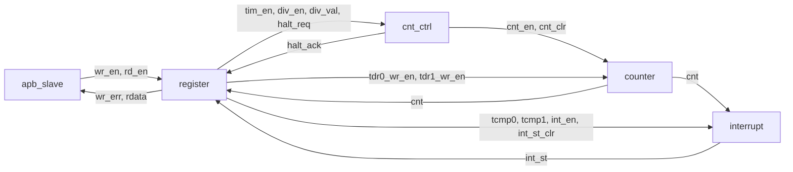

# timer_top – Specification / Đặc tả
Type: top · Parent: – · Level: L0

## Project overview / Tổng quan dự án

Timer IP derived from the RISC-V CLINT timer. A 64-bit up counter `cnt` = {TDR1, TDR0} is continuously compared with the 64-bit compare value {TCMP1, TCMP0}; on equality the pending bit `TISR.INT_ST` is set and, if `TIER.INT_EN` = 1, the level interrupt `tim_int` is raised. The IP is an APB slave (12-bit address, 32-bit data, 8 registers) with one wait state, byte strobes and error response. Advanced features: counting speed divided by 2^DIV_VAL (not a clock divider), hardware clear of the counter when `TIM_EN` falls, and counter halt in debug mode.

_VI:_ Timer IP tùy biến từ timer CLINT của RISC-V. Bộ đếm lên 64-bit `cnt` = {TDR1, TDR0} được so sánh liên tục với giá trị so sánh 64-bit {TCMP1, TCMP0}; khi bằng nhau, bit chờ ngắt `TISR.INT_ST` được set và nếu `TIER.INT_EN` = 1 thì ngắt mức `tim_int` lên 1. IP là APB slave (địa chỉ 12-bit, dữ liệu 32-bit, 8 thanh ghi) có một chu kỳ chờ, byte strobe và error response. Tính năng Advanced: chia tốc độ đếm theo 2^DIV_VAL (không phải chia clock), phần cứng xóa bộ đếm khi `TIM_EN` xuống 0, và halt bộ đếm trong debug mode.

Clock/reset: a single clock domain `sys_clk` (rising edge); `sys_rst_n` asynchronous, active-low, resets every flip-flop. No CDC.

_VI:_ Clock/reset: một miền clock duy nhất `sys_clk` (sườn lên); `sys_rst_n` bất đồng bộ, tích cực mức thấp, reset mọi flip-flop. Không có CDC.

Decomposition follows the block diagram of the input (Figure 1): APB protocol handling, the register file, counting control, the 64-bit counter and the interrupt logic are independent functions with narrow interfaces; TDR0/TDR1 physically live in `counter`, `register` only produces their byte write enables.

_VI:_ Phân rã theo sơ đồ khối của input (Hình 1): xử lý giao thức APB, khối thanh ghi, điều khiển đếm, bộ đếm 64-bit và logic ngắt là các chức năng độc lập với interface hẹp; TDR0/TDR1 nằm vật lý trong `counter`, `register` chỉ tạo tín hiệu cho phép ghi theo byte cho chúng.

Naming: top-level port names and internal signal names are taken unchanged from the input (Table 1, Table 11); the `_i`/`_o` suffix convention is not applied because the input defines the names. Sub-module ports carry the same name as the net they connect to.

_VI:_ Đặt tên: tên port top và tên tín hiệu nội bộ lấy nguyên từ input (Bảng 1, Bảng 11); không áp dụng hậu tố `_i`/`_o` vì input đã quy định tên. Port của module con mang đúng tên net mà nó nối tới.

## Function / Chức năng

See Project overview. Register map: `doc/spec/register_file/register_map.md`.

_VI:_ Xem Tổng quan dự án. Bảng thanh ghi: `doc/spec/register_file/register_map.md`.

## Interface

| Port name | Direction | Width | Type | Connects to | Description |
| --- | --- | --- | --- | --- | --- |
| `sys_clk` | in | 1 | CLK/RST | apb_slave.sys_clk, register.sys_clk, cnt_ctrl.sys_clk, counter.sys_clk, interrupt.sys_clk | System clock, rising edge |
| `sys_rst_n` | in | 1 | CLK/RST | apb_slave.sys_rst_n, register.sys_rst_n, cnt_ctrl.sys_rst_n, counter.sys_rst_n, interrupt.sys_rst_n | Asynchronous active-low reset |
| `tim_psel` | in | 1 | CTRL | apb_slave.tim_psel | APB select |
| `tim_pwrite` | in | 1 | CTRL | apb_slave.tim_pwrite | 1: write, 0: read |
| `tim_penable` | in | 1 | CTRL | apb_slave.tim_penable | APB enable (access phase) |
| `tim_paddr` | in | 12 | DATA | register.tim_paddr | APB address; decoded on `tim_paddr[11:2]` |
| `tim_pwdata` | in | 32 | DATA | register.tim_pwdata, counter.tim_pwdata | APB write data |
| `tim_pstrb` | in | 4 | CTRL | register.tim_pstrb | Write strobe: bit i = 1 writes byte i |
| `tim_prdata` | out | 32 | DATA | apb_slave.tim_prdata | APB read data, valid when `tim_pready` = 1 |
| `tim_pready` | out | 1 | STATUS | apb_slave.tim_pready | APB ready; 0 in the wait cycle, 1 in the last cycle |
| `tim_pslverr` | out | 1 | STATUS | apb_slave.tim_pslverr | Write error, asserted together with `tim_pready` |
| `tim_int` | out | 1 | STATUS | interrupt.tim_int | Timer interrupt, active-high, level |
| `dbg_mode` | in | 1 | CTRL | cnt_ctrl.dbg_mode | Debug mode indication, used for halt (see OPEN-001) |

## Structure / Cấu trúc

| Instance | Module | Role |
| --- | --- | --- |
| `u_apb_slave` | `apb_slave` | APB transfer: wait state, error response, `wr_en`/`rd_en`, `tim_prdata` = `rdata` |
| `u_register` | `register` | Address decode, TCR/TCMP0/TCMP1/TIER/THCSR, byte write, `wr_err`, TDR write enables, `int_st_clr`, read mux |
| `u_cnt_ctrl` | `cnt_ctrl` | `cnt_en` from TIM_EN/DIV_EN/DIV_VAL, halt, `cnt_clr` on TIM_EN H→L |
| `u_counter` | `counter` | 64-bit counter {TDR1, TDR0}: count, software byte write, clear |
| `u_interrupt` | `interrupt` | Compare `cnt` with {TCMP1, TCMP0}, INT_ST, `tim_int` |

No glue logic: the top only instantiates and connects. Internal nets (width): `wr_en` 1, `rd_en` 1, `wr_err` 1, `rdata` 32, `tim_en` 1, `div_en` 1, `div_val` 4, `halt_req` 1, `halt_ack` 1, `tdr0_wr_en` 4, `tdr1_wr_en` 4, `tcmp0` 32, `tcmp1` 32, `int_en` 1, `int_st_clr` 1, `int_st` 1, `cnt_en` 1, `cnt_clr` 1, `cnt` 64.

_VI:_ Không có glue logic: top chỉ instance và nối dây. Net nội bộ và độ rộng như liệt kê ở trên.

## Behavior / Hành vi

System-level behavior is defined by the sub-module specs. Key end-to-end timing:

- APB transfer: setup – wait – access, 3 cycles; register write takes effect at the clock edge ending the access cycle (`wr_en` = 1).
- Writing TIM_EN 1 → 0: `tim_en` = 0 from the next cycle, `cnt_clr` pulses in that cycle, `cnt` = 0 one cycle later.
- `cnt` == {TCMP1, TCMP0} in cycle T → INT_ST = 1 (and `tim_int` = 1 if INT_EN) from T+1.

_VI:_ Hành vi mức hệ thống do spec các module con định nghĩa. Định thời chính:

- Giao dịch APB: setup – wait – access, 3 chu kỳ; ghi thanh ghi có hiệu lực ở sườn clock kết thúc chu kỳ access (`wr_en` = 1).
- Ghi TIM_EN 1 → 0: `tim_en` = 0 từ chu kỳ kế tiếp, `cnt_clr` là xung trong chu kỳ đó, `cnt` = 0 sau đó một chu kỳ.
- `cnt` == {TCMP1, TCMP0} ở chu kỳ T → INT_ST = 1 (và `tim_int` = 1 nếu INT_EN) từ T+1.

## Reset

All flip-flops reset asynchronously by `sys_rst_n` = 0; reset values are listed in the register map and sub-module specs.

_VI:_ Mọi flip-flop reset bất đồng bộ khi `sys_rst_n` = 0; giá trị reset liệt kê trong register map và spec các module con.
